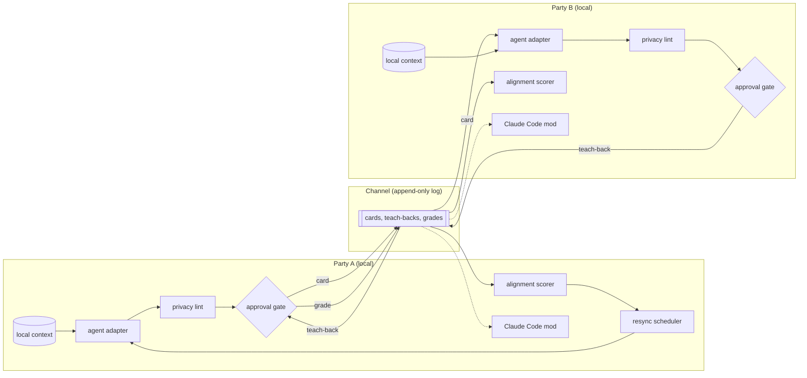

# Architecture

Parity has six components and a Claude Code mod. Five components run on each party's machine. One, the channel, sits between the two machines and holds everything that crosses. The mod reads only what already crossed, the local copy of the log, and never local context.

| Component | Runs where | Role | Status |
|---|---|---|---|
| Agent adapter | local | Drafts cards and restatements from local context | implemented (`engine/src/adapter/`) |
| Approval gate | local | Blocks any object from leaving until a human approves the object | implemented (`gate.ts`) |
| Channel | between parties | Append-only log of cards, teach-backs, grades, term checks | implemented (memory + HTTP relay; git not built) |
| Alignment scorer | local | Scores restatement fidelity and term-check outcomes | implemented (`scorer.ts`) |
| Resync scheduler | local | Decides when the next card is due | implemented (`scheduler.ts`) |
| Privacy boundary | local | Lints a draft against local context before the approval gate | implemented (`lint.ts`) |
| Claude Code mod | local | Shows sync status, grounds every agent in the approved cards, holds handoffs until synced | implemented (`claude-code/`) |

## Data flow



One round, in order:

1. The resync scheduler on A's side signals that a card is due, or a person types `parity card`.
2. A's agent adapter drafts a card from A's local context.
3. A's privacy lint flags any string in the draft that also appears in local context outside the evidence pointers.
4. A edits the draft and approves the card at the approval gate. Only an approved card reaches the channel.
5. The channel appends the card.
6. B's agent adapter reads the card and drafts a teach-back. B's privacy lint and approval gate run on the teach-back the same way.
7. The channel appends the teach-back.
8. A grades the teach-back as right, partly right, or wrong, with a per-term grade for each key term. The channel appends the grade.
9. Both alignment scorers read the log and update the alignment score for the pair. Both Claude Code mods read the new entries.
10. For any term graded partly right or wrong, both parties run a term check, and the round repeats with a revised card.

## Components

### Agent adapter

The adapter is the only component that reads a party's prompts, transcripts, and working files. The adapter exposes two operations.

- `draft_card(context) -> card` with `status: draft`.
- `draft_teachback(card, context) -> teachback` with `status: draft`.

The adapter is model-agnostic. Implementations: Claude API, scripted (demo/tests), manual (`$EDITOR`). The adapter never writes to the channel.

### Approval gate

The gate holds every draft until the owning human marks the draft approved. The gate presents the draft, the privacy lint findings, and a diff against the previous approved card from the same party. Approval records a hash of the approved text. Nothing reaches the channel without an approval record, and the channel rejects any object whose hash does not match an approval record.

### Channel

The channel is an append-only log. Entries are never edited or deleted. Each entry is one of: `card`, `teachback`, `grade`, `termcheck`, `termverdict`. Each carries an author, a timestamp, a sequence number, content id, reference id, and approval hash. Transport: in-memory (tests), HTTP relay inside the CLI (default), git-backed (not built).

Every client re-verifies every entry it receives (`rules.ts`), so a dishonest relay cannot slip an unapproved or altered entry past either party.

### Alignment scorer

The scorer reads only the channel and produces restatement fidelity (weighted fields; wrong on `decision` scores zero), term acceptance, and drift between rounds. Both parties run it on the same log and get the same numbers.

### Resync scheduler

Inputs: drift estimate, turns since last card, cost `c`, misalignment price `k`, max interval. Issues a card request when cumulative expected misalignment exceeds `c`, or the max interval passes. Never sends on a party's behalf.

### Privacy boundary

Local context is readable only by the adapter and the lint. Only objects with an approval record cross. The pre-send lint: denylist + verbatim context scan (eight or more consecutive words). Marks, never removes. Paraphrased leaks remain a human responsibility, as the threat model below says.

### Claude Code mod

Reads `.parity/config.json` and `.parity/log.jsonl`, nothing else. Shows status above the prompt and in a `/parity` pane. Adds the approved cards, and any drifted term with both readings, to Claude's system prompt and to the brief of every spawned agent. Holds agent-team teammate spawns, pull requests, pushes, and merges until synced, as `gateMode` says. Details in [claude-code.md](claude-code.md).

## Card schema

Engineering card (engine): `problem`, `decision`, `constraints`, `acceptance`, `evidence`, `key_terms` (definition + optional examples), `would_change_my_mind`. Research card in the README uses `claim` in place of `decision` and omits constraints/acceptance. Teach-backs reuse the card shape. Grades: overall + per field + per term + one-sentence note.

Full JSON Schema sketch remains below for the research-shaped card; the engine enforces the engineering shape in `schema.ts`.

```json
{
  "$schema": "https://json-schema.org/draft/2020-12/schema",
  "$id": "https://example.invalid/parity/card.schema.json",
  "title": "Parity position card",
  "type": "object",
  "additionalProperties": false,
  "required": ["id", "author", "problem", "claim", "evidence", "key_terms", "would_change_my_mind", "status"],
  "properties": {
    "id": { "type": "string", "description": "Content hash of the approved fields" },
    "author": { "type": "string" },
    "previous": { "type": ["string", "null"], "description": "id of the author's previous card, if any" },
    "problem": { "$ref": "#/$defs/sentence" },
    "claim": { "$ref": "#/$defs/sentence" },
    "evidence": {
      "type": "array",
      "minItems": 0,
      "maxItems": 3,
      "items": {
        "type": "object",
        "additionalProperties": false,
        "required": ["summary", "pointer"],
        "properties": {
          "summary": { "$ref": "#/$defs/sentence" },
          "pointer": { "type": "string", "description": "URL, DOI, file path, or citation" }
        }
      }
    },
    "key_terms": {
      "type": "object",
      "minProperties": 1,
      "maxProperties": 5,
      "additionalProperties": {
        "type": "object",
        "additionalProperties": false,
        "required": ["examples", "non_examples"],
        "properties": {
          "examples": { "type": "array", "minItems": 3, "maxItems": 3, "items": { "$ref": "#/$defs/sentence" } },
          "non_examples": { "type": "array", "minItems": 3, "maxItems": 3, "items": { "$ref": "#/$defs/sentence" } }
        }
      }
    },
    "would_change_my_mind": { "$ref": "#/$defs/sentence" },
    "status": { "type": "string", "enum": ["draft", "approved"] },
    "approval": {
      "type": "object",
      "additionalProperties": false,
      "required": ["approved_at", "open_lint_flags"],
      "properties": {
        "approved_at": { "type": "string", "format": "date-time" },
        "open_lint_flags": { "type": "integer", "minimum": 0 }
      }
    }
  },
  "$defs": {
    "sentence": { "type": "string", "minLength": 1, "maxLength": 300 }
  },
  "if": { "properties": { "status": { "const": "approved" } } },
  "then": { "required": ["approval"] }
}
```

## Threat model

### What crosses the channel

Approved cards, approved teach-backs, grades, term checks, and term verdicts. Prompts, transcripts, working files, and the agent's own reasoning stay local.

### What a malicious or careless counterparty can extract

Everything in an approved card; position over time via the log; terms and examples; teach-back style as a probe of the other agent; metadata (timestamps, latency).

### What the counterparty cannot extract

Local context, by construction.

### What the approval gate stops

Unapproved egress; altered bodies (approval hash); verbatim denylist and long context-span leaks the lint catches.

### What the approval gate does not stop

Paraphrased leaks; approval fatigue; a dishonest stated position; own-side sycophancy the author agrees with; inference from the public log.

### What the Claude Code mod adds

A hold at the handoff, and agents that know what each person approved. No new data surface: the mod reads only the local copy of the log, which holds only entries their authors approved. With `gateMode: off` the mod still shows status and grounds agents, and holds nothing.
