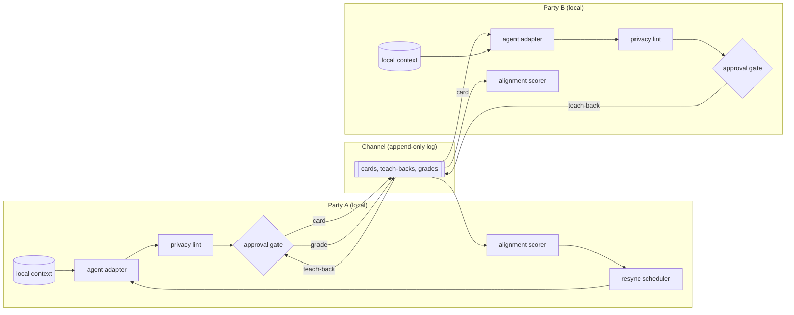

# Architecture

Sketch only. No component described here is implemented.

Parity has six components. Five run on each party's machine. One, the channel, sits between the two machines and holds everything that crosses.

| Component | Runs where | Role |
|---|---|---|
| Agent adapter | local | Drafts cards and restatements from local context |
| Approval gate | local | Blocks any object from leaving until a human approves the object |
| Channel | between parties | Append-only log of cards, teach-backs, and grades |
| Alignment scorer | local | Scores restatement fidelity and term-check outcomes |
| Resync scheduler | local | Decides when the next card is due |
| Privacy boundary | local | Lints a draft against local context before the approval gate |

## Data flow



One round, in order:

1. The resync scheduler on A's side signals that a card is due.
2. A's agent adapter drafts a card from A's local context.
3. A's privacy lint flags any string in the draft that also appears in local context outside the evidence pointers.
4. A edits the draft and approves the card at the approval gate. Only an approved card reaches the channel.
5. The channel appends the card.
6. B's agent adapter reads the card and drafts a teach-back. B's privacy lint and approval gate run on the teach-back the same way.
7. The channel appends the teach-back.
8. A grades the teach-back as right, partly right, or wrong, with a per-term grade for each key term. The channel appends the grade.
9. Both alignment scorers read the log and update the alignment score for the pair.
10. For any term graded partly right or wrong, both parties run a term check, and the round repeats with a revised card.

## Components

### Agent adapter

The adapter is the only component that reads a party's prompts, transcripts, and working files. The adapter exposes two operations.

- `draft_card(context) -> card` with `status: draft`.
- `draft_teachback(card, context) -> teachback` with `status: draft`.

The adapter is model-agnostic. Any local model, hosted model, or human can fill the role. The adapter never writes to the channel.

### Approval gate

The gate holds every draft until the owning human marks the draft approved. The gate presents the draft, the privacy lint findings, and a diff against the previous approved card from the same party. Approval flips `status` to `approved` and records a hash of the approved text. Nothing reaches the channel without an approval record, and the channel rejects any object whose hash does not match an approval record.

The gate is a human step by design. An agent may propose edits, and the human makes the final change.

### Channel

The channel is an append-only log. Entries are never edited or deleted. Each entry is one of three kinds.

| Kind | Author | Refers to |
|---|---|---|
| `card` | one party | the previous card from the same party, if any |
| `teachback` | the other party | one card |
| `grade` | the card's author | one teach-back |

Each entry carries an author, a timestamp, a sequence number, the hash of the entry the entry refers to, and the approval hash. The channel is transport-agnostic: a shared file, an email thread, a git branch, or a message queue all serve. The sketch uses a simulated channel, which is a single JSON Lines file that both simulated parties append to in turn.

### Alignment scorer

The scorer reads only the channel and produces two numbers per round.

- **Restatement fidelity.** The fraction of card fields the author graded right, weighted so that `claim` and `key_terms` count double. A teach-back graded wrong on `claim` scores zero regardless of the other fields.
- **Term-check outcome.** For each key term, the fraction of the other party's examples and non-examples that the term's author accepts. A term with acceptance below a threshold is marked mismatched.

The scorer also emits a drift estimate: the change in fidelity between consecutive rounds. The scorer never reads local context, so both parties can run the scorer and get the same numbers.

### Resync scheduler

The scheduler decides when the next card is due. Inputs are the drift estimate from the scorer, the number of turns since the last approved card, and two constants the party sets: a resync cost `c` and a misalignment price `k`. The scheduler issues a card request when the cumulative expected misalignment since the last resync exceeds `c`, or when a fixed maximum interval passes, whichever comes first. The expected misalignment follows the drift model in the README. The scheduler never sends anything on a party's behalf.

### Privacy boundary

The boundary wraps the adapter and the gate. Two rules hold.

1. Local context is readable only by the adapter and the lint.
2. Only objects with an approval record cross the boundary.

The pre-send lint runs on every draft before the gate shows the draft to the human. The lint has a denylist and a context scan.

- **Denylist.** Strings the party registers in advance: names, project codenames, file paths, credentials, unreleased numbers.
- **Context scan.** Every span of the draft longer than a set length that matches a span in local context verbatim. Evidence pointers are exempt, since a pointer is meant to name a source.

The lint marks, and never removes. The human sees each flagged span with the matching source and decides. Approval with open flags is allowed and recorded as such.

## Card schema

```json
{
  "$schema": "https://json-schema.org/draft/2020-12/schema",
  "$id": "https://example.invalid/parity/card.schema.json",
  "title": "Parity position card",
  "type": "object",
  "additionalProperties": false,
  "required": ["id", "author", "problem", "claim", "evidence", "key_terms", "would_change_my_mind", "status"],
  "properties": {
    "id": { "type": "string", "description": "Content hash of the approved fields" },
    "author": { "type": "string" },
    "previous": { "type": ["string", "null"], "description": "id of the author's previous card, if any" },
    "problem": { "$ref": "#/$defs/sentence" },
    "claim": { "$ref": "#/$defs/sentence" },
    "evidence": {
      "type": "array",
      "minItems": 0,
      "maxItems": 3,
      "items": {
        "type": "object",
        "additionalProperties": false,
        "required": ["summary", "pointer"],
        "properties": {
          "summary": { "$ref": "#/$defs/sentence" },
          "pointer": { "type": "string", "description": "URL, DOI, file path, or citation" }
        }
      }
    },
    "key_terms": {
      "type": "object",
      "minProperties": 1,
      "maxProperties": 5,
      "additionalProperties": {
        "type": "object",
        "additionalProperties": false,
        "required": ["examples", "non_examples"],
        "properties": {
          "examples": { "type": "array", "minItems": 3, "maxItems": 3, "items": { "$ref": "#/$defs/sentence" } },
          "non_examples": { "type": "array", "minItems": 3, "maxItems": 3, "items": { "$ref": "#/$defs/sentence" } }
        }
      }
    },
    "would_change_my_mind": { "$ref": "#/$defs/sentence" },
    "status": { "type": "string", "enum": ["draft", "approved"] },
    "approval": {
      "type": "object",
      "additionalProperties": false,
      "required": ["approved_at", "open_lint_flags"],
      "properties": {
        "approved_at": { "type": "string", "format": "date-time" },
        "open_lint_flags": { "type": "integer", "minimum": 0 }
      }
    }
  },
  "$defs": {
    "sentence": { "type": "string", "minLength": 1, "maxLength": 300 }
  },
  "if": { "properties": { "status": { "const": "approved" } } },
  "then": { "required": ["approval"] }
}
```

Teach-backs reuse the card schema with `author` set to the other party and `previous` set to the card id. Grades are a separate object: `{ "teachback": id, "overall": "right" | "partly" | "wrong", "terms": { term: "right" | "partly" | "wrong" } }`.

## Threat model

### What crosses the channel

Approved cards, approved teach-backs, and grades. Each carries an author, a timestamp, a sequence number, hashes, and the text of the fixed fields. Nothing else crosses. Prompts, transcripts, working files, and the agent's own reasoning stay local.

### What a malicious or careless counterparty can extract

- **Everything in an approved card.** The counterparty reads the card in full. A card that names a method, a dataset, or a result discloses that method, dataset, or result. The schema bounds the size of a disclosure, not the sensitivity.
- **Position over time.** The log keeps every card. A reader can diff consecutive cards and watch a position change, which reveals what moved the author.
- **Terms and examples.** Examples and non-examples are chosen from the author's experience. A careless author picks examples from unreleased work.
- **Agent behavior.** Teach-backs show how the counterparty's agent reads. A reader can probe the agent by sending crafted cards and watching restatements.
- **Metadata.** Timestamps and sequence numbers reveal working hours and response latency.

### What the counterparty cannot extract

Local context, by construction: the adapter reads local context, and only approved objects leave. A counterparty who controls the channel transport sees the same log as both parties and nothing more.

### What the approval gate stops

- Any object leaving without a human reading the object first.
- Any object that differs from the text the human approved, since the channel checks the approval hash.
- Verbatim leaks that the lint catches: denylisted strings and long spans copied from local context.

### What the approval gate does not stop

- **Paraphrased leaks.** The lint matches strings. An agent that rewords a private fact passes the lint, and only the human can catch the reworded fact.
- **Approval fatigue.** A human who approves without reading turns the gate into a pass-through. The gate records approval time and open flags, which lets a later audit find rubber stamping, and stops nothing in the moment.
- **A dishonest party.** Nothing forces a party to approve a card that states their real position. The protocol detects misunderstanding between stated positions, and a stated position can be false.
- **Agent distortion that the human agrees with.** An agent that softens a position in a way the author finds agreeable passes the gate. Sycophancy on the author's own side is the residual risk the README names.
- **Inference from the log.** Everything in the previous section is available to any reader of the log, and the gate does not reason about what a counterparty can infer.
